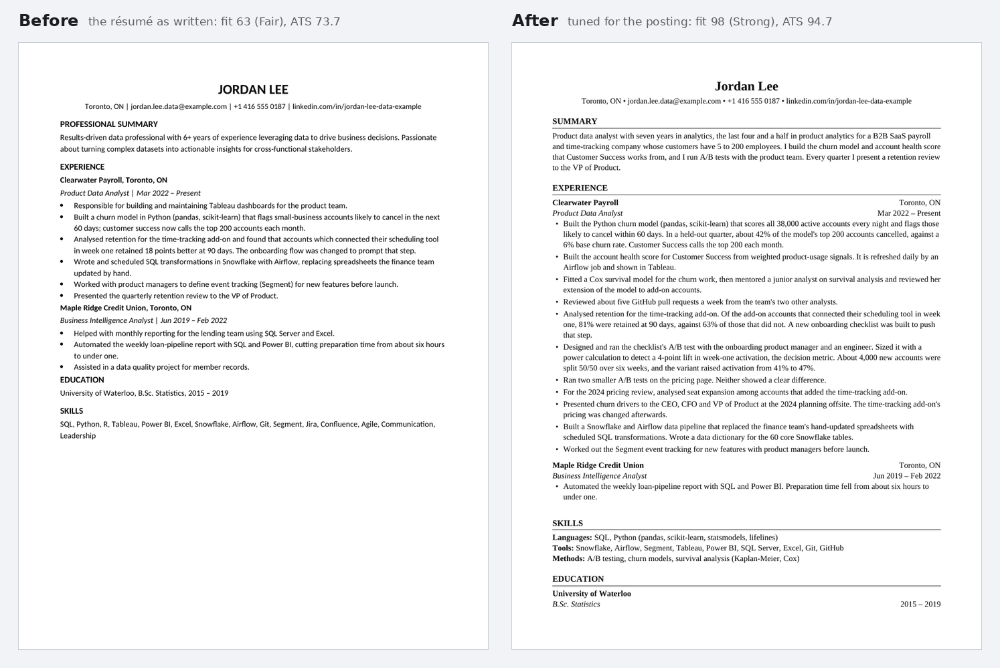
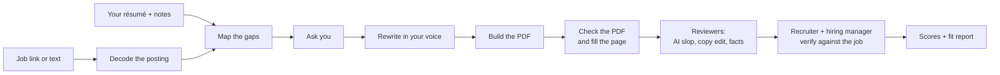

# Résumé JD Tuner

[](https://github.com/RajdeepDas43/resume-jd-tuner/actions/workflows/ci.yml)
[](LICENSE)

A Claude skill that tailors your résumé to one job posting without inventing anything, and then tells you how well you fit.

Give it a job link (or the posting's text) and your résumé. You get back two files:

- A one-page tuned résumé as a PDF. Your real experience is reordered and reworded for this job. The posting's keywords appear in its exact spelling wherever they are true for you, and the PDF's text layer is one that ATS parsers read cleanly.
- A fit report. It gives your overall fit before and after tuning, your ATS alignment against an honest ceiling, the interview questions your résumé will trigger with a risk level for each, the gaps worth closing, and the quality checks the page passed.



## Why another résumé tool

Most "ATS optimizers" add keywords until a match score turns green. A recruiter then reads the page the ATS ranked, and a stuffed, LLM-polished résumé is easy to spot. This skill aims at that recruiter.

- It rewords, reorders, cuts and quantifies what you did, and invents nothing. A requirement you don't meet goes into the report as a gap.
- The job's hard terms (tools, platforms, certifications) go on the page only where they are true for you, in the posting's spelling. The posting's sentences, adjectives and title stay out.
- A script flags the usual signs of machine writing, such as em dashes, "leveraged", trailing "-ing" clauses and phrases lifted from the posting. Reviewer agents then read the page as a recruiter would.
- If the tuned résumé leaves space at the bottom, it fills that space with true, relevant detail in your experience and summary. When your material runs out, it asks you targeted questions. Widening the layout comes last, and the report says when it was needed.
- Every check runs on the compiled PDF, because that is what the ATS receives: page count, garbled or glued words, headers, contact details, clickable links.
- A hiring-manager agent grades your original and the tuned résumé against every requirement in the same pass, without being told which is which. Fixed, published formulas turn those grades into the fit and ATS numbers.

## How it works



1. **Get the posting.** It fetches the link. If the site needs a login (LinkedIn, Indeed), it stops and asks you to paste the posting rather than guess at it.
2. **Decode it** into must-haves, nice-to-haves, responsibilities, exact hard terms and eligibility rules.
3. **Read your résumé** (PDF, DOCX, LaTeX or text) and any notes you point it to, and map where it is strong or thin against each requirement.
4. **Ask you** one batch of questions about whatever the job centres on that your résumé doesn't settle.
5. **Rewrite** in plain language. The PDF uses your own LaTeX template if you have one, and a clean Harvard-style layout otherwise.
6. **Check the PDF and fill the page** with relevant, true content.
7. **Review the draft** with three agents: an AI-slop screener, a copy editor and a fact-checker.
8. **Verify it against the job** with two more: a recruiter who runs the ATS searches and decides on a shortlist, and a hiring manager who grades every requirement and writes the interview questions.
9. **Score it** and write the report.

## Install

### Claude Code

As a plugin:

```text
/plugin marketplace add RajdeepDas43/resume-jd-tuner
/plugin install resume-jd-tuner@resume-jd-tuner
```

Or copy the skill folder:

```bash
git clone https://github.com/RajdeepDas43/resume-jd-tuner
cp -r resume-jd-tuner/skills/resume-jd-tuner ~/.claude/skills/
```

### Claude apps (claude.ai, Desktop, Cowork)

1. Download `resume-jd-tuner.zip` from the [latest release](https://github.com/RajdeepDas43/resume-jd-tuner/releases), or build it with `python3 tools/build_zip.py`.
2. Turn on **Code execution and file creation** in Settings → Capabilities.
3. Open **Customize → Skills**, click **+**, choose **Create skill → Upload a skill**, and upload the zip.

### Other agents

The skill follows the open Agent Skills format: a `SKILL.md` with scripts, references and assets beside it. Agents that read that format can load `skills/resume-jd-tuner/` as it is.

### Requirements

Python 3.9+ with `reportlab` 4.0.4+, `pypdf` 5.1+ and `pdfminer.six`:

```bash
python3 -m pip install -r requirements.txt
python3 skills/resume-jd-tuner/scripts/check_env.py   # shows what's installed and what's missing
```

Optional: `pdftotext` from poppler (a second PDF reader, closer to what many ATS use), and a LaTeX engine if your résumé is a `.tex` file.

## Use it

Ask in your own words:

- "Tailor my résumé for this job: https://jobs.lever.co/… (résumé attached)"
- "Here's a job description [paste]. My CV is ~/Documents/cv.docx. Am I a fit?"
- "Tune resume.tex for this posting and keep my template."
- "Check my résumé against this JD for ATS keywords."

A few things make the result better. Point it to your notes: a brag document or a list of projects gives it true material to fill the page with. Answer its questions: one fact about the size of your data, or who used your work, can turn a weak requirement into a clear one. And if some things must read the same on every résumé (degree wording, items never to mention, spelling, location, profile links, numbers you can defend), put them in a `resume-conventions.md` in your résumé folder, starting from [`assets/conventions_template.md`](skills/resume-jd-tuner/assets/conventions_template.md).

Each run creates one folder per application:

```text
acme-data-analyst/
├── Your_Name_Data_Analyst.pdf    # the tuned résumé (plus .tex on the LaTeX path)
├── fit_report.md                 # the fit report
├── job_posting.txt               # the posting as fetched or pasted
└── work/                         # decoded posting, grades, checks, reviewer verdicts, review log
```

## Example

[`examples/data-scientist/`](examples/data-scientist/) is a complete run: a fictional product data analyst applying for a fictional senior data scientist role. It includes the input résumé, the notes, the posting, the candidate's answers to the skill's questions, the tuned PDF, the fit report and every intermediate file, down to each review agent's full reply.

| Measure | Before | After |
|---|---|---|
| Overall fit (0-100) | 63 (Fair) | 98 (Strong) |
| Must-haves shown clearly | 5 of 8 | 8 of 8 |
| ATS alignment (0-100) | 73.7 | 94.7 (honest ceiling 94.7) |
| Must-have hard terms present | 6 of 7 | 7 of 7 |

## How the scores work

- **Overall fit.** The hiring-manager agent grades each requirement "clear", "weak" or "none" (worth 1, 0.5 and 0) for both versions of the résumé. Must-haves weigh 3, responsibilities 2 and nice-to-haves 1. Scores of 85 and up are Strong, 70 to 84 Good, 55 to 69 Fair, and below 55 a Long shot. A must-have the page doesn't show caps the band.
- **ATS alignment.** The share of the posting's hard terms found on the page in the posting's spelling, with must-haves counted twice. The honest ceiling is the best score possible without claiming anything untrue, and the tuned résumé aims to reach it.
- **Interview risk.** High if any claim on the page would be hard to back up in an interview, Medium if any would need preparation, Low otherwise.

The grades are a model's judgment; the formulas are fixed. The numbers estimate what the page proves. They are not the score any particular ATS computes (Workday, Greenhouse and the rest all differ), and they are not your odds of an interview. Details are in [`references/scoring.md`](skills/resume-jd-tuner/references/scoring.md).

## Privacy

- The scripts run wherever Claude runs them (your machine in Claude Code, a sandbox in the Claude apps) and make no network calls. The only network access is the agent fetching the job link you give it.
- Your résumé and the posting are part of your conversation with Claude, like any file you share.
- Run the skill from your own job-search folder, not inside a clone of this repository, so your résumés never end up in a commit.

## Limitations

- Output is PDF (plus `.tex` for LaTeX users). Word output isn't supported yet.
- Postings behind a login (LinkedIn, Indeed, Glassdoor) can't be fetched; paste the text instead.
- Scanned (image-only) résumés need converting to text first.
- The bundled font covers Latin, Greek and Cyrillic scripts. Names in other scripts need a different font.
- One page by default; two only for 10+ years of relevant experience, or when you ask.
- The reviewer and recruiter agents run in parallel where Claude can start separate agents. Where it can't, Claude plays each one in turn, and the report says so.

## Repository layout

```text
skills/resume-jd-tuner/      the skill: SKILL.md, scripts/, references/, assets/
.claude-plugin/              plugin and marketplace manifests for Claude Code
examples/                    a complete worked example
evals/                       test prompts and fictional fixtures for evaluating the skill
tests/                       unit tests for the scripts
tools/build_zip.py           builds dist/resume-jd-tuner.zip for the Claude apps
```

## Development

```bash
python3 -m pip install -r requirements.txt -r requirements-dev.txt
pytest -q                          # unit tests for every script
ruff check .                       # lint
claude plugin validate .           # plugin and marketplace manifests
python3 tools/build_zip.py --check # the upload zip, in dist/, with a layout check
```

CI runs all of this on every push and pull request, on Linux, macOS and Windows, and against the oldest dependency versions the skill supports. Pushing a `vX.Y.Z` tag publishes a release; [CONTRIBUTING.md](CONTRIBUTING.md) has the steps.

[`evals/`](evals/) holds four end-to-end test cases with fictional candidates: a job link, a pasted posting with a DOCX résumé, a LaTeX résumé, and a job link that can't be fetched. [CONTRIBUTING.md](CONTRIBUTING.md) explains how to run them and how to propose changes.

## License

[Apache License 2.0](LICENSE). The bundled Liberation Serif fonts are under the [SIL Open Font License 1.1](skills/resume-jd-tuner/assets/fonts/LICENSE-OFL.txt); see [NOTICE](NOTICE).

## Disclaimer

This tool helps you present your real experience clearly. It doesn't guarantee interviews or offers. Read every line before you send it, because you are the one who has to stand behind it in the interview.
